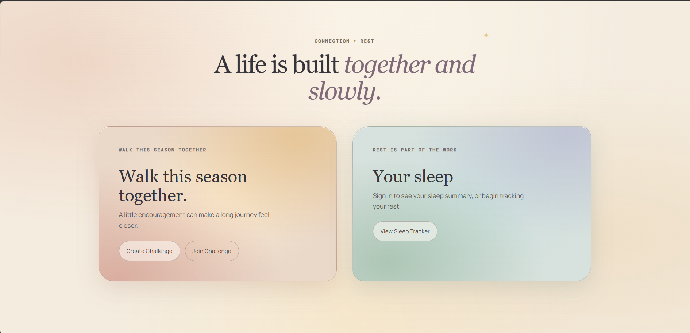

# Winter Arc

### Guided by God, Built by You.

Winter Arc is a full-stack, 92-day personal growth and wellness app for turning broad intentions into a steady daily practice. It brings ritual tracking, sleep and habit records, reflections, and progress reviews into one guided experience—so users can focus on showing up and learning from their own journey.

[](https://react.dev/)
[](https://vite.dev/)
[](https://supabase.com/)
[](https://vercel.com/)

**Live app:** [winter-arc-three-gilt.vercel.app](https://winter-arc-three-gilt.vercel.app)

**Repository:** [github.com/GanjiManogna/Winter-Arc](https://github.com/GanjiManogna/Winter-Arc)

## Screenshots

### Landing page


### Connection and rest



## The problem Winter Arc addresses

Personal goals are easy to set and hard to sustain. Habit tracking can also become fragmented across daily checklists, notes, and retrospective reviews. Winter Arc gives a 92-day practice a clear daily structure, while keeping room for rest, reflection, and personal changes to habits over time.

## Product features

- **Daily rituals:** Track eleven core rituals using completion, numeric values, or timestamped events, depending on the ritual.
- **Sunscreen log:** Record application times and track whether the day's application goal is complete. Reminder scheduling observes a 7 PM local-time cutoff.
- **Sleep Tracker:** Record bedtime and wake-up times. Durations are calculated across midnight and rejected when invalid or longer than 16 hours.
- **Custom habits:** Create boolean or measurable habits, archive them, and retain dated definitions for historical views.
- **Progress and reflection:** Review daily progress and history, explore weekly and monthly analysis, and save weekly and monthly reflections.
- **Friends Challenge:** Create private challenges, invite members, and compare aggregate completion progress.
- **Account access:** Register, sign in, sign out, and protect authenticated routes with Supabase Auth.
- **Reminders and installability:** Opt in to browser push notifications and install the responsive app as a Progressive Web App (PWA) on supported browsers.

## Technology

| Area | Implementation |
| --- | --- |
| Frontend | React 19, JavaScript, JSX, CSS, Vite 8 |
| Routing | React Router 7 |
| Authentication and client | Supabase Auth, `@supabase/supabase-js` |
| Data | Supabase PostgreSQL, SQL migrations, Row Level Security (RLS) |
| Server-side jobs | Supabase Edge Function, PostgreSQL `pg_cron`, Supabase Vault |
| Push notifications | Web Push, service worker, VAPID |
| Hosting | Vercel |
| Tests and lint | Node.js built-in test runner, ESLint 10 |

There is no separate Express.js or Node.js API server. Supabase provides the managed authentication, database, and Edge Function services used by the application.

## System architecture

```mermaid
flowchart LR
  user[User] --> app[React application]
  app --> client[Supabase JavaScript client]
  client -->|sign-in and session| auth[Supabase Auth]
  auth -->|authenticated session| client
  client --> dataApi[Supabase Data API]
  dataApi --> db[(PostgreSQL)]
  db --> rls{RLS authorization using auth.uid()}
  rls --> rows[Account-owned rows]
  client --> challenge[Authenticated challenge RPCs]
  challenge --> db

  cron[PostgreSQL pg_cron] --> dispatch[Database dispatcher function]
  vault[Supabase Vault] --> dispatch
  dispatch -->|HTTPS request| edge[Notification Edge Function]
  edge --> db
  edge --> push[Web Push services]
  push --> sw[Browser service worker]
  sw --> user
```

The browser uses the Supabase client for sign-in and data operations. PostgreSQL policies enforce ownership at the database boundary. Friends Challenge uses narrowly scoped RPC functions for operations that need to inspect multiple members' data. Scheduled notification delivery runs server-side; a service worker receives and displays push events in the browser.

RLS is evaluated inside PostgreSQL for client data requests; the separate RLS node in the diagram represents that authorization check, not a separate service.

## Supabase backend

### Authentication and sessions

The Supabase client is configured from the Vite environment variables below. The auth provider reads the current session and subscribes to auth-state changes. Authenticated routes wait for session initialization and redirect signed-out users to login. The client checks the current user before account-scoped operations; the database then applies RLS to the request.

### PostgreSQL persistence and RLS

The SQL migrations define account-owned program data, daily ritual entries, custom habit definitions, dated ritual snapshots, reflections, notification preferences and subscriptions, delivery records, and Friends Challenge tables. Core user data uses `user_id` ownership checks against `auth.uid()`. Child records also use owner-aware foreign keys so a record cannot be attached to another user's program by substituting a related ID.

RLS policies keep each account's personal entries, sleep data, and reflections private. The Supabase browser client uses the public anon/publishable key; no service-role key is included in the frontend. RLS is a database control, so authorization does not depend only on hiding UI routes.

### Migrations and schema evolution

Database changes are stored as ordered SQL files in [`supabase/migrations/`](supabase/migrations/). They define the schema, constraints, policies, RPCs, notification delivery ledger, and Friends Challenge operations. Keeping changes in migration files makes the intended schema changes reviewable and repeatable. Apply them to a Supabase project using a reviewed database migration workflow; the README does not assume that a fresh Supabase project already has this schema.

### Edge Functions and push delivery

The `notification-dispatcher` Supabase Edge Function handles scheduled push delivery outside the browser. A PostgreSQL `pg_cron` job invokes it using dispatch configuration held in Supabase Vault. The function validates the dispatch secret, reads due preferences and active subscriptions, and sends Web Push notifications using server-side VAPID credentials. A delivery-events table with a per-device uniqueness constraint prevents duplicate claims for the same scheduled slot. The browser service worker handles received push events and notification clicks.

The VAPID public key may be configured in the browser as `VITE_VAPID_PUBLIC_KEY`. The VAPID private key, dispatch secret, and other privileged values belong only in Supabase's server-side secret configuration.

The dispatcher reads `SUPABASE_URL`, `SUPABASE_SERVICE_ROLE_KEY`, `NOTIFICATION_DISPATCH_SECRET`, `VAPID_PUBLIC_KEY`, `VAPID_PRIVATE_KEY`, and `VAPID_SUBJECT` from its Edge Function environment. The scheduled database function reads the `notification_project_url`, `notification_publishable_key`, and `notification_dispatch_secret` values from Supabase Vault. These are names only; do not commit their values. In particular, `SUPABASE_SERVICE_ROLE_KEY` must remain server-side.

## Technical Highlights

- **Ritual-specific data models:** Boolean rituals store completion; measurable rituals store values and apply goals; Sunscreen stores ordered application timestamps. Sleep is informational and does not count toward completion totals.
- **Historical custom-habit definitions:** Each date can retain a ritual snapshot containing the definition and order that applied that day. History can therefore render the earlier label and settings after a habit is renamed, reordered, or archived.
- **Overnight sleep calculations:** Sleep and wake times are validated as local `HH:mm` values. If wake time is earlier than bedtime, the calculation treats wake-up as the following day, then rejects non-positive or over-16-hour intervals.
- **Account switching and stale requests:** The account data controller clears the previous account's cloud snapshot before loading another identity. Request versions and user identity checks prevent a late response for the previous account from replacing the current account's data.
- **Notification delivery safety:** The server dispatcher evaluates due times in each account's configured timezone, creates a unique delivery claim per device and scheduled slot, and deactivates subscriptions reported as permanently invalid by push providers.
- **Database-enforced authorization:** RLS and ownership constraints protect ordinary account data. Friends Challenge has an additional aggregate-only RPC boundary described below.

## Friends Challenge privacy architecture

Friends Challenge lets members compare participation without sharing their private daily records. Its privacy boundary is implemented in the database as well as in the React interface:

1. **Ownership and membership:** `winter_arc_challenges` stores the owner; `winter_arc_challenge_members` records the owner and each joined member. The create and join functions validate the signed-in user, challenge dates, invite code, active status, and membership state. Only an owner can end a challenge; a member can leave.
2. **Direct table access is revoked:** RLS is enabled on the challenge tables, and direct table privileges are revoked from `public`, `anon`, and `authenticated`. Authenticated clients use the granted RPC functions instead of querying challenge rows directly.
3. **RPCs validate identity and membership:** The `SECURITY DEFINER` functions use a fixed empty `search_path`, check `auth.uid()`, and verify membership before returning challenge details. Execute permission is granted to the `authenticated` role, not anonymous users.
4. **Progress is minimized:** The private progress function calculates a percentage from completed core boolean/measurable ritual entries and the challenge's elapsed eligible ritual-days. It excludes custom habits and the informational Sleep Tracker. The read RPC returns member display names, roles, and percentages for the leaderboard; it does not return individual ritual rows or values.
5. **Personal records remain private:** Daily ritual entries, sleep records, and weekly/monthly reflections remain under their account-specific RLS policies. The challenge RPC reads records internally to calculate a percentage, but exposes only that aggregate to challenge members.

The implementation is in [`20261004110000_friends_challenge_v1.sql`](supabase/migrations/20261004110000_friends_challenge_v1.sql) and [`src/data/challengeRepository.js`](src/data/challengeRepository.js).

## Run locally

### Requirements

- Node.js 20.19+ or 22.12+
- npm

### Install

```bash
git clone https://github.com/GanjiManogna/Winter-Arc.git
cd Winter-Arc
npm install
```

### Configure Supabase

1. Create or select a Supabase project.
2. Copy `.env.example` to `.env.local`.
3. Set the project URL and public anon/publishable key in `.env.local`:

   ```dotenv
   VITE_SUPABASE_URL=https://your-project.supabase.co
   VITE_SUPABASE_ANON_KEY=your-public-anon-or-publishable-key
   VITE_VAPID_PUBLIC_KEY=
   ```

4. Apply the SQL migrations in [`supabase/migrations/`](supabase/migrations/) to the project in filename order before using features that depend on their tables and functions. Use the Supabase SQL Editor or a separately configured Supabase CLI workflow; review each migration before applying it.
5. For scheduled push delivery, configure the server-side VAPID and dispatch secrets for the Edge Function and the Vault values used by the database scheduler. Do not put these secrets in `.env.local` or any `VITE_` variable.

The app can start without Supabase environment values for local-first use, but authentication and cloud-backed features require a configured Supabase project and its database schema.

### Start the development server

```bash
npm run dev
```

Vite prints the local URL, typically `http://localhost:5173`.

## Tests and verification

The repository uses Node's built-in test runner. Run the complete suite with:

```bash
npm test
```

Create a production build with:

```bash
npm run build
```

The production build is generated in `dist/`. Use `npm run preview` to serve that build locally. Run `npm run lint` for ESLint.

**Verification for this README revision:** `npm test` passed all 213 tests. `npm run build` completed successfully; Vite reported that the minified JavaScript bundle (666.14 kB in this build) exceeds its 500 kB advisory threshold.

These local checks do not validate the hosted Supabase project's migration state or real push delivery.

## What I learned

- Building a React application that uses Supabase Auth and a managed PostgreSQL backend.
- Modeling dated user activity, versioned habit definitions, and relational ownership constraints.
- Applying RLS policies and authenticated database functions to protect personal data and expose limited aggregates.
- Organizing schema evolution as SQL migrations.
- Moving scheduled notification work to a serverless Edge Function and handling browser push through a service worker.
- Isolating account data during sign-in changes and guarding against stale asynchronous responses.
- Deploying a client-side application to Vercel and maintaining automated tests for its data and interaction logic.

## Project structure

```text
src/
  auth/          Supabase authentication and route access
  components/    Application pages and interface components
  data/          Ritual models, progress, analysis, repositories, and writes
  notifications/ Browser notification preferences and subscriptions
  pwa/           Service worker registration
supabase/
  functions/     Notification Edge Function
  migrations/    PostgreSQL schema and policy changes
tests/           Node.js automated tests
docs/            Architecture notes and screenshots
```

## Security notes

- `.env.local` is ignored by Git; do not commit local environment files.
- Vite exposes `VITE_` variables to browser code. Only use public client configuration there.
- Never put a Supabase service-role key, VAPID private key, dispatch secret, or database password in frontend code or repository files.
- Review and apply SQL migrations only to the intended Supabase project.

## License

No license file is currently included. Please contact the repository owner before reusing or redistributing this project.
